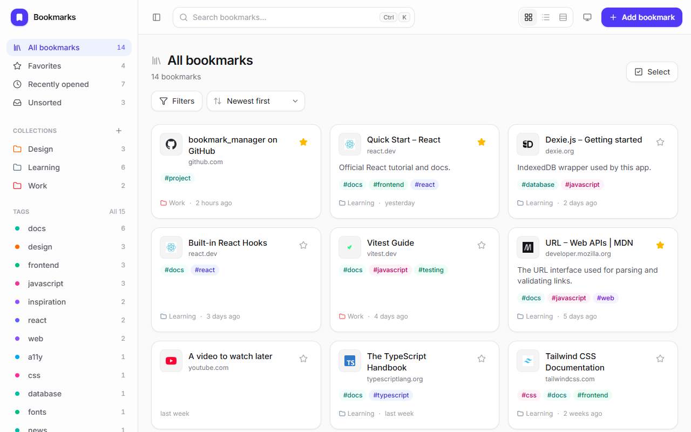
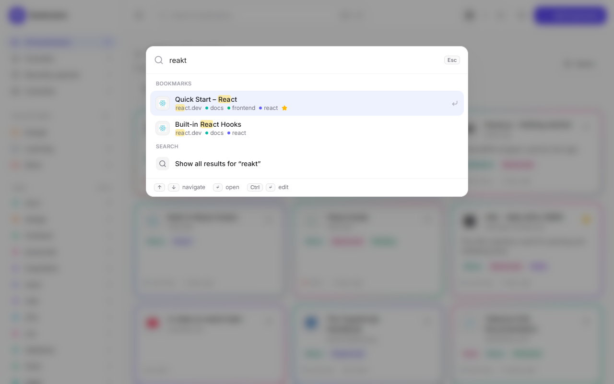
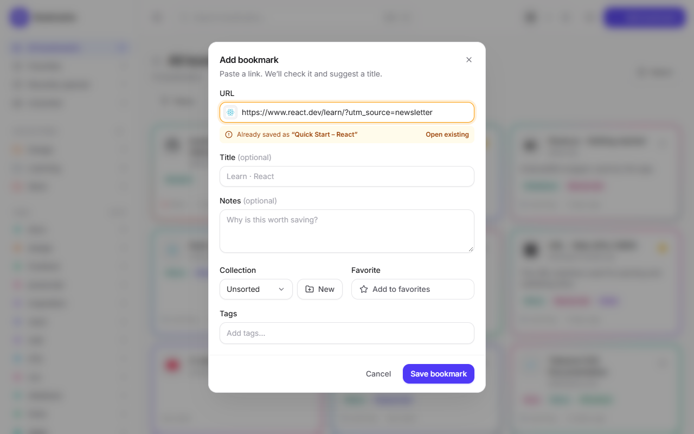
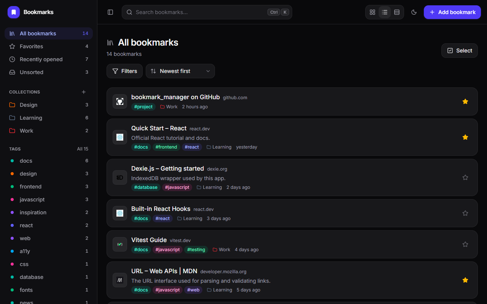
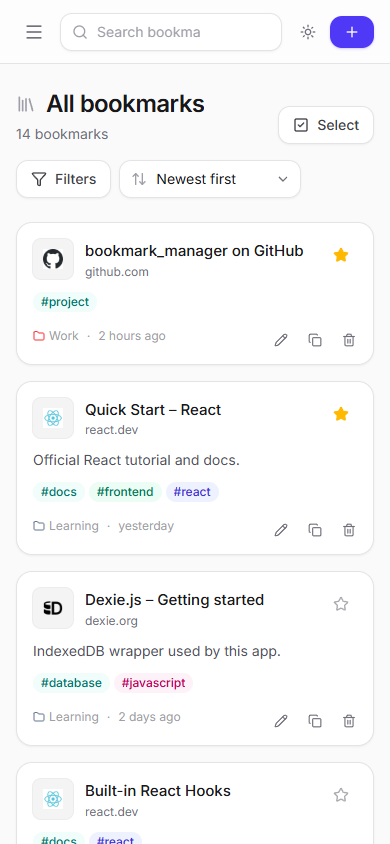

# Bookmark Manager

A modern, fast bookmark manager that runs entirely in your browser. Save links with titles, notes, tags and
collections, star your favorites, and find anything in seconds with fuzzy search and filters.

**Live demo: https://jcatibog014.github.io/bookmark_manager/**



| Quick search (`Ctrl+K`) | Duplicate detection | Dark theme · list view |
| --- | --- | --- |
|  |  |  |

<p align="center">
  <br>
  <em>Mobile layout</em>
</p>

## Features

**Saving links**
- Add, edit and delete bookmarks with title, notes, tags, collection and favorite
- **Live URL validation** as you type: adds `https://` for you, blocks unsafe schemes (`javascript:`, `data:`, `ftp:`…),
  checks the domain, and strips tracking parameters (`utm_*`, `fbclid`, …)
- **Duplicate detection**: `http://www.example.com/docs/` and `example.com/docs#intro` count as the same link, with a
  one-click "Open existing"
- Suggested titles and site icons from the URL

**Finding links**
- Fuzzy, typo-tolerant search over titles, sites, tags and notes, with highlighted matches
- `Ctrl+K` command palette: jump to bookmarks, tags, collections and actions. Paste a link there to save it
- Filters: favorites, recently opened, unsorted, collection, multiple tags (**match any / match all**), website,
  date added (presets or a custom range) and untagged
- Sort by newest, oldest, title, most visited or recently opened
- Every view is a URL (`/?tags=react,docs&mode=and&sort=title`), so it survives a refresh and can be bookmarked

**Organizing**
- Collections (each bookmark belongs to one) and tags (as many as you like), each with a color
- Tag manager: rename, recolor, merge, delete. Renaming a tag to an existing name merges the two
- Collection manager: rename, recolor, and delete with a choice to keep the bookmarks (moved to Unsorted) or delete them too
- Details panel with visit stats and **related bookmarks** (same site, or two or more shared tags)
- Multi-select (shift-click for a range) to favorite, tag, move or delete many bookmarks at once
- Undo after deleting

**Comfort**
- Grid, list and compact layouts; light, dark and system themes
- Responsive layout with a drawer menu on phones
- Keyboard shortcuts throughout (press `?` in the app)
- Import from Chrome, Edge, Firefox or Safari (`bookmarks.html`) or a JSON backup, with a report of what was added,
  skipped as duplicate, or rejected as invalid
- Export as a JSON backup or a browser-compatible HTML file

## Tech stack

| | |
| --- | --- |
| Language | TypeScript |
| UI | React 19, React Router, Tailwind CSS 4, lucide icons |
| Data | IndexedDB through [Dexie](https://dexie.org) (stored locally in the browser; no server or account) |
| Search | [Fuse.js](https://www.fusejs.io) |
| Tooling | Vite, Vitest, happy-dom, fake-indexeddb |

## Getting started

Requires [Node.js](https://nodejs.org) 20 or newer.

```bash
npm install
npm run dev        # http://localhost:5173
```

Click **Load sample bookmarks** on the empty screen to explore with example data.

| Script | What it does |
| --- | --- |
| `npm run dev` | Start the dev server with hot reload |
| `npm test` | Run the unit tests once (`npm run test:watch` to keep them running) |
| `npm run build` | Type-check and build for production into `dist/` |
| `npm run preview` | Serve the production build locally (http://localhost:4173/bookmark_manager/) |

## Deployment

Every push to `main` runs the tests, builds the app and publishes it to GitHub Pages through
[.github/workflows/deploy.yml](.github/workflows/deploy.yml).

## How it's built

### Data model (relationships)

```
Collection 1 ──── * Bookmark            bookmark.collectionId (null = Unsorted)
Bookmark   * ──── * Tag                 through the BookmarkTag join table

Bookmark    { id, url, normalizedUrl (unique), title, description, collectionId,
              isFavorite, visitCount, lastVisitedAt, createdAt, updatedAt }
Tag         { id, name (unique, lowercase), color }
BookmarkTag { bookmarkId, tagId }       compound primary key [bookmarkId+tagId]
Collection  { id, name, color, createdAt }
```

### Where to look

| Topic | File |
| --- | --- |
| URL validation, normalization, duplicate key | [src/lib/url.ts](src/lib/url.ts) |
| Filtering, sorting, URL query params, related bookmarks | [src/lib/filter.ts](src/lib/filter.ts) |
| Database schema | [src/db/db.ts](src/db/db.ts) |
| All writes: tags, merges, cascades, undo, import | [src/db/repo.ts](src/db/repo.ts) |
| Joining tables into view models | [src/lib/library.ts](src/lib/library.ts) |
| Import / export formats | [src/lib/importExport.ts](src/lib/importExport.ts) |
| Tests | [tests/](tests/) |

```
src/
  components/   UI building blocks (cards, form, palette, filter bar, dialogs)
  context/      app-wide state: live database data, UI state (theme, dialogs, toasts)
  db/           Dexie schema, repository functions, sample data
  hooks/        theme, hotkeys, debounce, bookmark actions
  lib/          pure logic: url, filter, search, library, import/export, formatting
  pages/        Home, Tags, Collections, Settings
tests/          Vitest unit tests
```

## Keyboard shortcuts

| Keys | Action |
| --- | --- |
| `Ctrl` `K` | Quick search & commands |
| `N` | Add a bookmark |
| `/` | Focus the search box |
| `?` | Show all shortcuts |
| `Enter` / `F` / `E` / `C` / `I` / `Del` | On a focused bookmark: open, favorite, edit, copy link, details, delete |
| `Shift` + click | Select a range |

## Privacy

Bookmarks never leave your browser. The only network requests are for site icons
(`google.com/s2/favicons`) and the Inter font. Clearing your browser's site data deletes your bookmarks, so use
**Settings → Export** for backups.
